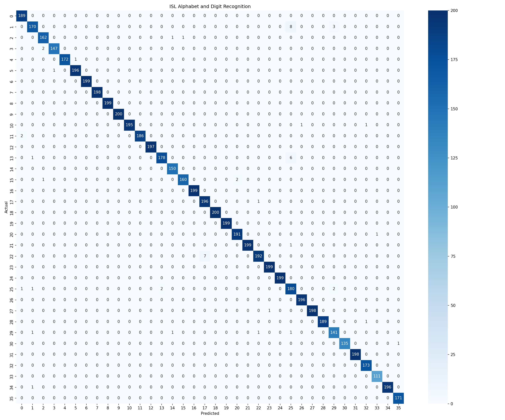

## Indian Sign Language (ISL) Recognition

Real-time Indian Sign Language (ISL) recognition system for 36 alphanumeric classes (digits `0`–`9` and alphabets `A`–`Z`). The framework extracts 3D hand landmarks via Google MediaPipe, transforms them into a normalized 126-dimensional invariant feature vector, and classifies gestures using a Random Forest ensemble with balanced class weights.


## Quickstart

### 1. Clone and Install

```bash
git clone https://github.com/px7nn/ISL.git
cd "ISL"
pip install -r requirements.txt
```

### 2. Run Live Recognition

Pretrained models are bundled in [`models/`](models/). Launch live webcam recognition directly:

```bash
python -m src
```

**Keyboard Controls:**
- `Space`: Append active prediction to sentence buffer
- `Backspace`: Delete previous character
- `c`: Clear text buffer
- `q`: Quit application

---

## Training and Dataset

Pretrained classification models are included. To retrain from scratch:
- **Dataset Archive:** Download [ISL Dataset from Kaggle](https://www.kaggle.com/api/v1/datasets/download/ananyaarya22/isl-data) and unpack into `datasets/isl_dataset/`.
- **Extraction:** Run `python scripts/extract_landmarks.py`
- **Training:** Run `python scripts/train.py`

---

## Model Evaluation

The trained model achieves >99% test accuracy across 36 classes on held-out evaluation samples.

<p align="center">
  
</p>

---

## Documentation

Detailed technical documentation is organized in [`docs/`](docs/):

- **[System Architecture](docs/architecture.md)**: Perception layer, geometric normalization pipeline, and state machine.
- **[Feature Extraction](docs/feature_extraction.md)**: 3D landmark topology, wrist-relative normalization, and dual-hand alignment.
- **[Dataset & Training](docs/dataset_and_training.md)**: Dataset acquisition, feature extraction pipeline, and classifier training.
- **[Real-Time Inference](docs/realtime_inference.md)**: Video feed loop, confidence gating, HUD overlay, and interactive controls.
- **[Setup & Usage Guide](docs/setup_and_usage.md)**: Environment installation, dataset instructions, and troubleshooting.
- **[API Reference](docs/api_reference.md)**: Public classes, functions, arguments, and module constants.
