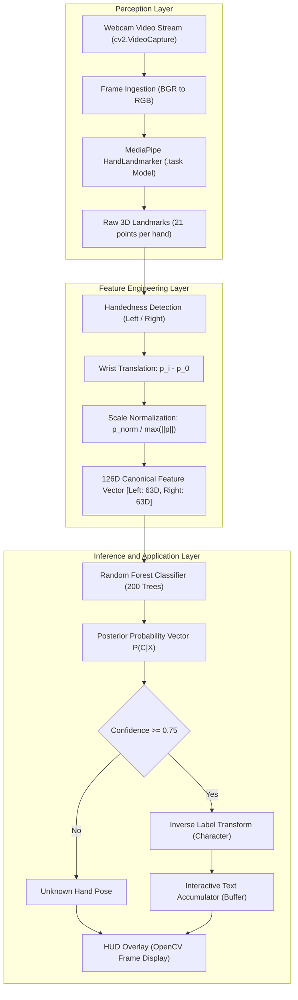
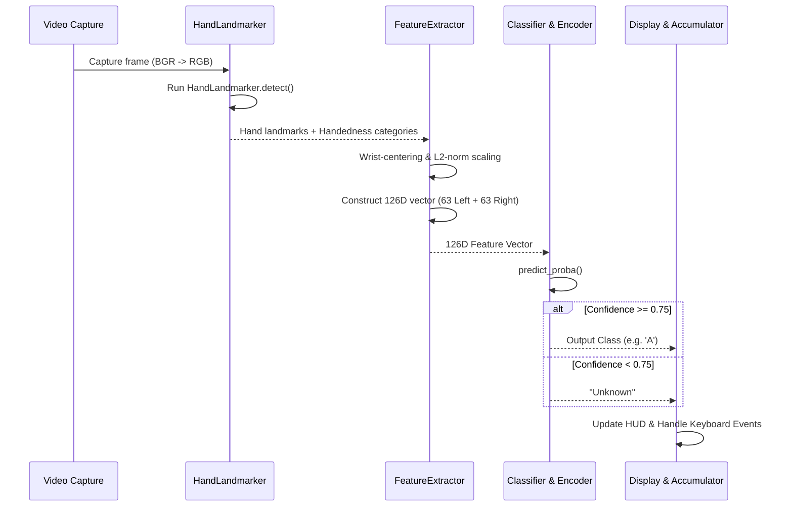
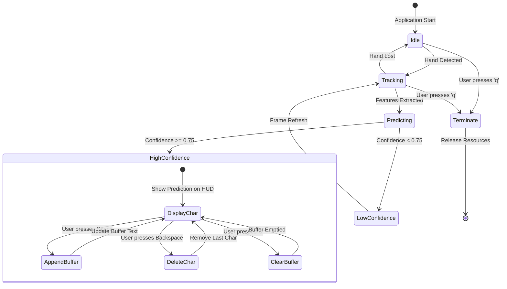

### [← Back to README](../README.md)

**Sections:** [System Overview](#system-overview) • [High-Level Architecture](#high-level-architecture) • [Data Flow and Pipeline](#data-flow-and-pipeline) • [Core Components](#core-components) • [Coordinate Systems and Transformations](#coordinate-systems-and-transformations) • [State Machine for Sentence Accumulation](#state-machine-for-sentence-accumulation) • [Latency and Performance Profile](#latency-and-performance-profile)

---

 

# System Architecture

## System Overview

The Indian Sign Language (ISL) Recognition System is an end-to-end computer vision and machine learning framework designed for real-time recognition of 36 distinct sign classes (alphanumeric characters: digits 0-9 and letters A-Z). 

Unlike conventional deep-learning approaches that feed raw image pixels directly into heavy convolutional neural networks (CNNs), this system decouples perception from classification. Spatial landmark detection is offloaded to Google MediaPipe Tasks API, and invariant geometric normalization maps 3D landmark topologies into a structured 126-dimensional feature vector. Classification is performed by an ensemble Random Forest model, providing sub-millisecond inference latencies suitable for continuous real-time video streams on commodity CPU hardware.

## High-Level Architecture

The architecture consists of three principal layers:
1. **Perception Layer:** Video frame ingestion via OpenCV and 3D hand topology detection using Google MediaPipe Hand Landmarker.
2. **Feature Engineering Layer:** Geometric normalization, wrist-relative transformation, scale standardization, and handedness alignment.
3. **Inference & Application Layer:** Probabilistic ensemble classification, confidence gating, interactive text accumulation, and visual feedback rendering.

## Data Flow and Pipeline

The execution workflow is split into two distinct modes: **Offline Dataset Pipeline** and **Online Real-Time Pipeline**.

## Core Components

The codebase is organized modularly to isolate landmark detection, mathematical normalization, dataset generation, and model execution:

| Component | File Reference | Primary Responsibility |
| :--- | :--- | :--- |
| **Detector** | [`HandLandmarker`](../src/hand_landmarker.py) | Encapsulates Google MediaPipe Tasks Hand Landmarker, initializes model parameters, and executes detection over RGB image arrays. |
| **Feature Extractor** | [`extract_features`](../src/feature_extractor.py) | Processes landmark objects, extracts 3D world coordinates, normalizes scale and translation, and slots features into canonical Left/Right hand vectors. |
| **Normalizer** | [`normalize_hand`](../src/feature_extractor.py) | Shifts landmarks relative to the wrist origin and normalizes by the maximum Euclidean distance to enforce scale invariance. |
| **Visualizer** | [`overlay_hand_landmarks`](../src/hand_landmarker.py) | Renders landmark joints and skeletal bone connections on the OpenCV image frame. |
| **Dataset Builder** | [`extract_landmarks.py`](../scripts/extract_landmarks.py) | Iterates over raw ISL image directories, runs batch feature extraction, and serializes `.npy` binary arrays. |
| **Trainer** | [`train.py`](../scripts/train.py) | Loads feature matrices, calculates balanced class weights, trains an ensemble Random Forest, produces confusion matrix evaluations, and exports serialized models. |
| **Application Loop** | [`__main__.py`](../src/__main__.py) | Drives the webcam loop, executes real-time inference, manages confidence thresholds, and handles text buffer modifications. |

## Coordinate Systems and Transformations

### MediaPipe Landmark Coordinate Spaces

MediaPipe Hand Landmarker outputs two sets of 3D landmark representations:
1. **Normalized Image Coordinates (`hand_landmarks`):** 
   - $x$ and $y$ are normalized to $[0.0, 1.0]$ relative to image width and height.
   - $z$ represents landmark depth relative to the wrist, with a negative scale indicating points closer to the camera.
2. **World Coordinates (`hand_world_landmarks`):**
   - Metric 3D coordinates representing real-world Euclidean space in meters, with the origin placed at the geometric center of the hand.
   - This system configures the feature extractor with `world=True`, maximizing orientation stability and minimizing perspective distortion caused by optical lens effects.

### Geometric Invariance Pipeline

To ensure the classifier remains robust against varying user positions, hand sizes, and distances from the camera, landmarks undergo a two-stage geometric transformation:

1. **Translation Invariance (Wrist Centering):**
   Given 21 landmarks $\mathbf{P} = \{\mathbf{p}_0, \mathbf{p}_1, \dots, \mathbf{p}_{20}\}$, where $\mathbf{p}_0 = (x_0, y_0, z_0)$ is the wrist joint:
   $$\mathbf{p}'_i = \mathbf{p}_i - \mathbf{p}_0 \quad \forall i \in \{0, 1, \dots, 20\}$$
   After translation, $\mathbf{p}'_0 = (0, 0, 0)$.

2. **Scale Invariance (Maximum L2 Norm):**
   The maximum Euclidean distance from the wrist to any landmark is computed:
   $$s = \max_{i} \|\mathbf{p}'_i\|_2 = \max_i \sqrt{(x'_i)^2 + (y'_i)^2 + (z'_i)^2}$$
   If $s \ge 10^{-6}$, the coordinates are normalized:
   $$\hat{\mathbf{p}}_i = \frac{\mathbf{p}'_i}{s}$$
   This bounds all coordinates to the unit sphere while preserving proportional finger configurations.

## State Machine for Sentence Accumulation

The real-time interface provides an interactive state machine for composing words and sentences using recognized signs:

## Latency and Performance Profile

Decoupling visual tracking from classification achieves real-time execution speeds on low-power devices:
- **MediaPipe Hand Landmarker:** ~15 ms to 25 ms per frame (CPU-based inference via TFLite runtime).
- **Feature Extraction & Normalization:** < 0.15 ms per frame (vectorized NumPy operations).
- **Random Forest Inference:** < 0.8 ms per prediction (200 decision trees traversed sequentially/parallelized via OpenMP).
- **Total Pipeline Latency:** ~18 ms to 28 ms per frame, comfortably exceeding 30 frames per second (FPS) standard webcam throughput.
