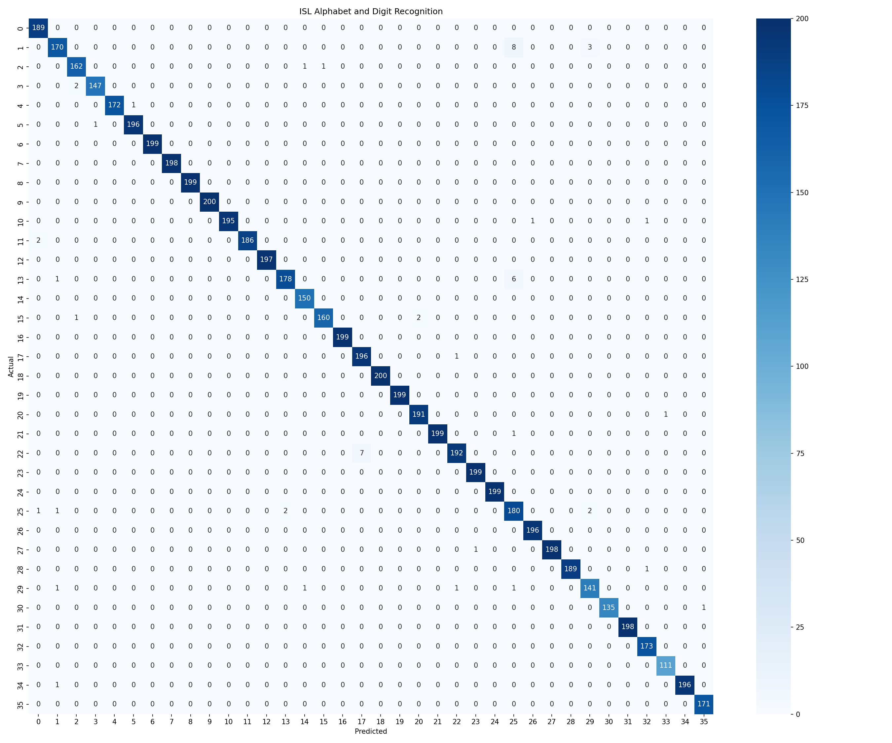

### [← Back to README](../README.md)

**Sections:** [Overview](#overview) • [Dataset Acquisition and Structure](#dataset-acquisition-and-structure) • [Feature Extraction Pipeline](#feature-extraction-pipeline) • [Preprocessed Binary Caching](#preprocessed-binary-caching) • [Model Training and Architecture](#model-training-and-architecture) • [Class Weight Balancing Strategy](#class-weight-balancing-strategy) • [Performance Evaluation](#performance-evaluation) • [Confusion Matrix Analysis](#confusion-matrix-analysis) • [Model Serialization Artifacts](#model-serialization-artifacts)

---

<br/>

# Dataset Preparation and Model Training

## Overview

The machine learning pipeline processes labeled image datasets of Indian Sign Language (ISL), translates each image into standardized 126-dimensional topological feature vectors, and trains an ensemble Random Forest classifier.

This document details dataset acquisition, dataset structure, extraction procedures, data caching formats, hyperparameter selection, class-weight balancing, and performance evaluation metrics.

## Dataset Acquisition and Structure

The raw dataset can be downloaded directly from Kaggle:
- **Download Link:** [ISL Dataset Archive (Kaggle)](https://www.kaggle.com/api/v1/datasets/download/ananyaarya22/isl-data)

Unpack the archive contents into `datasets/isl_dataset/`. The directory structure contains 36 alphanumeric classes:
- **Digits (10 classes):** `0`, `1`, `2`, `3`, `4`, `5`, `6`, `7`, `8`, `9`
- **Alphabets (26 classes):** `A`, `B`, `C`, `D`, `E`, `F`, `G`, `H`, `I`, `J`, `K`, `L`, `M`, `N`, `O`, `P`, `Q`, `R`, `S`, `T`, `U`, `V`, `W`, `X`, `Y`, `Z`

```
datasets/
└── isl_dataset/
    ├── 0/
    │   ├── 0_0.jpg
    │   └── ...
    ├── 1/
    ├── ...
    ├── A/
    │   ├── A_0.jpg
    │   └── ...
    └── Z/
```

Supported image formats include `.jpg`, `.jpeg`, `.png`, `.bmp`, and `.webp`. The extraction pipeline automatically ignores checkpoint directories such as `.ipynb_checkpoints`.

## Feature Extraction Pipeline

Feature extraction is managed by [`scripts/extract_landmarks.py`](../scripts/extract_landmarks.py).

The script iterates through all class directories, passes images to [`HandLandmarker`](../src/hand_landmarker.py), and invokes [`extract_features`](../src/feature_extractor.py):

```bash
python scripts/extract_landmarks.py
```

### Extraction Workflow:
1. Initialize the MediaPipe hand detection model (`models/hand_landmarker.task`).
2. Read each image via OpenCV (`cv2.imread`).
3. Run perception tracking. If no hands are detected or if landmarks are degraded, the sample is tracked in a failure counter.
4. Extract 3D normalized coordinates with `world=True` to eliminate perspective distortion.
5. Append valid 126D vectors and corresponding class labels to memory buffers.
6. Export the processed matrices to binary NumPy archives.

## Preprocessed Binary Caching

Extracted data is stored in `datasets/processed/` using binary `.npy` format:

| File | Shape / Type | Description |
| :--- | :--- | :--- |
| `features.npy` | `(33071, 126)`, `float32` | Normalized 126-dimensional landmark vectors for all valid samples. |
| `labels.npy` | `(33071,)`, `string` | Corresponding ground-truth class labels (e.g. `'0'`, `'A'`, `'Z'`). |
| `classes.npy` | `(36,)`, `string` | Sorted array of unique class names representing model target vocabulary. |

Binary caching separates time-consuming vision extraction from fast iterative model training. Extracting 33,000+ images requires several minutes; loading cached `.npy` arrays requires under 150 milliseconds.

## Model Training and Architecture

Training is orchestrated by [`scripts/train.py`](../scripts/train.py).

### Data Preparation
1. **Label Encoding:** Labels are converted from string representations into contiguous integers using `sklearn.preprocessing.LabelEncoder`.
2. **Stratified Split:** Data is partitioned into an 80% training set and a 20% test set using `train_test_split(test_size=0.2, stratify=y, random_state=42)`. Stratification ensures class balance is identical across train and test splits.

### Classifier Hyperparameters
The classification engine uses `sklearn.ensemble.RandomForestClassifier`:

```python
model = RandomForestClassifier(
    n_estimators=200,
    max_depth=None,
    min_samples_split=2,
    min_samples_leaf=1,
    n_jobs=-1,
    random_state=42,
    class_weight=class_weights
)
```

- `n_estimators=200`: 200 decision trees provide robust variance reduction and high predictive stability.
- `max_depth=None`: Trees expand until leaves are pure or contain fewer than `min_samples_split`.
- `n_jobs=-1`: Distributes tree construction across all available CPU cores.
- `class_weight=class_weights`: Explicitly balances class frequencies.

## Class Weight Balancing Strategy

In landmark extraction across diverse datasets, certain signs (such as signs with complex finger occlusions) exhibit higher failure rates during perception. To prevent the model from biasing toward classes with higher sample retention, explicit balanced class weights are calculated using `sklearn.utils.class_weight.compute_class_weight`:

$$w_c = \frac{N}{|C| \cdot N_c}$$

Where:
- $N$ is total training samples.
- $|C|$ is total number of classes (36).
- $N_c$ is number of samples belonging to class $c$.

These weights scale the impurity criteria during tree splits, penalizing misclassifications in less-frequent classes proportionally.

## Performance Evaluation

Executing [`scripts/train.py`](../scripts/train.py) evaluates the trained model against the unseen 20% test split (6,615 samples):

```bash
python scripts/train.py
```

### Metrics Summary:
- **Overall Accuracy:** > 99%
- **Macro Average F1-Score:** > 0.99
- **Weighted Average F1-Score:** > 0.99
- **Inference Time per Sample:** < 1 ms

The ensemble model exhibits near-zero cross-class confusion due to the high discriminative power of the normalized 3D joint distance features.

## Confusion Matrix Analysis

The confusion matrix generated during training illustrates the classification performance across all 36 classes:

<p align="center">
  
</p>

### Key Observations:
- **Strong Diagonal Dominance:** High diagonal concentration confirms consistent classification fidelity across all 10 numeric digits and 26 alphabetic characters.
- **Minimal Cross-Talk:** Sub-millimeter landmark distinctions differentiate structurally similar sign pairs (such as `1` vs `D`, or `V` vs `2`).
- **Two-Hand Distinctions:** Classes requiring coordinated two-hand input (e.g. `W`, `X`, `P`, `Q`) exhibit zero interference with single-handed gestures due to the partitioned 126D feature layout.

## Model Serialization Artifacts

Upon evaluation completion, artifacts are exported to `models/`:
1. `models/isl_classifier.pkl`: Serialized `RandomForestClassifier` instance containing the ensemble tree structures (~8.8 MB, zlib-compressed for repository distribution).
2. `models/label_encoder.pkl`: Serialized `LabelEncoder` containing the inverse mapping from integer predictions back to alphanumeric strings.
