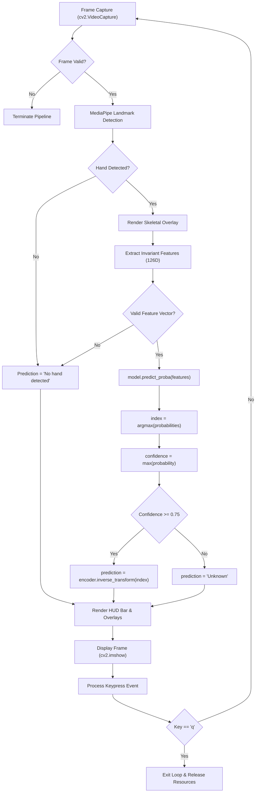

### [← Back to README](../README.md)

**Sections:** [Overview](#overview) • [Inference Pipeline Flow](#inference-pipeline-flow) • [Confidence Thresholding Mechanism](#confidence-thresholding-mechanism) • [Heads-Up Display (HUD) and Visual Overlay](#heads-up-display-hud-and-visual-overlay) • [Interactive Sentence Accumulator](#interactive-sentence-accumulator) • [Keyboard Control Reference](#keyboard-control-reference) • [Real-Time Performance and Optimization](#real-time-performance-and-optimization)

---

<br/>

# Real-Time Inference and Live Interface

## Overview

The live inference subsystem, implemented in [`src/__main__.py`](../src/__main__.py), integrates computer vision perception, machine learning classification, visual HUD rendering, and interactive text composition into a single real-time loop.

The application captures frames from a standard USB or integrated webcam, tracks up to two hands simultaneously, computes invariant 3D features, and outputs live classification predictions at 30+ frames per second.

## Inference Pipeline Flow

The execution cycle inside [`main()`](../src/__main__.py) executes sequentially for each captured video frame:



## Confidence Thresholding Mechanism

A frequent challenge in sign language recognition is distinguishing intentional signs from transitional gestures as a user moves their hands into position.

To prevent erratic false positives, the system applies a strict probability threshold:
```python
CONFIDENCE_THRESHOLD = 0.75
```

1. **Probability Distribution:** The Random Forest classifier computes posterior class probabilities via `model.predict_proba(features)[0]`.
2. **Maximum Probability Extraction:**
   $$c_{\max} = \arg\max_{c} P(c \mid \mathbf{x}), \quad \gamma = P(c_{\max} \mid \mathbf{x})$$
3. **Threshold Gating:**
   - If $\gamma \ge 0.75$: The prediction is confirmed and mapped through [`encoder.inverse_transform`](../src/__main__.py).
   - If $\gamma < 0.75$: The prediction is assigned as `"Unknown"`. This prevents ambiguous intermediate postures from being committed as false characters.

## Heads-Up Display (HUD) and Visual Overlay

The live interface provides clear, low-latency visual feedback drawn directly onto the video canvas using OpenCV primitives:

1. **Top Status Bar:**
   A semi-transparent dark banner (`(30, 30, 30)` RGB) is rendered across the top 100 pixels of the window (`cv2.rectangle`).
2. **Prediction Display:**
   Displays `Prediction: <CHAR>` in bright green (`(0, 255, 0)`) font when a confident prediction is active, or white/gray during transitional states.
3. **Confidence Meter:**
   Displays `Confidence: XX.X%` in white text (`(255, 255, 255)`), providing immediate verification of gesture clarity.
4. **Skeletal Landmark Overlay:**
   Rendered by [`overlay_hand_landmarks`](../src/hand_landmarker.py):
   - **Joint Vertices:** 21 green circles (`(0, 255, 0)`) with radius 4 px at each anatomical joint.
   - **Bones / Connections:** Red lines (`(0, 0, 255)`) with thickness 2 px connecting anatomical bone pairs according to MediaPipe's `HAND_CONNECTIONS` topology.

## Interactive Sentence Accumulator

Users can compose sentences letter-by-letter directly through the keyboard while gesturing. The accumulated sentence is tracked in memory and printed live to the standard output terminal.

```python
sentence = ""
```

When a stable prediction is confirmed (excluding `"Unknown"`, `"No hand detected"`, or `"Waiting..."`), pressing the composition keys mutates the buffer in real time.

## Keyboard Control Reference

The real-time loop responds to standard keypresses captured via `cv2.waitKey(1) & 0xFF`:

| Key | ASCII Code | Action Description |
| :---: | :---: | :--- |
| `Space` | `32` | **Append Character:** Appends the current active prediction character to the sentence buffer. |
| `Backspace` | `8` | **Delete Character:** Removes the last character in the sentence buffer (`sentence = sentence[:-1]`). |
| `c` | `99` | **Clear Buffer:** Resets the entire sentence string to empty (`sentence = ""`). |
| `q` | `113` | **Quit Application:** Gracefully breaks the main inference loop, closes the camera stream, and destroys OpenCV windows. |

Terminal status updates are emitted via carriage return:
```
Text: HELLO WORLD
```

## Real-Time Performance and Optimization

To ensure smooth 30+ FPS responsiveness on standard hardware:
- **Direct Memory Re-use:** Video frames are captured directly into pre-allocated NumPy array buffers.
- **Resource Management:** Memory and camera handles are bound inside a `try ... finally` block, ensuring [`detector.close()`](../src/hand_landmarker.py), [`cap.release()`](../src/__main__.py), and [`cv2.destroyAllWindows()`](../src/__main__.py) are reliably executed upon exit or on error.
- **CPU Execution:** Inference does not require GPU acceleration; the Random Forest evaluates in parallel across CPU threads.
