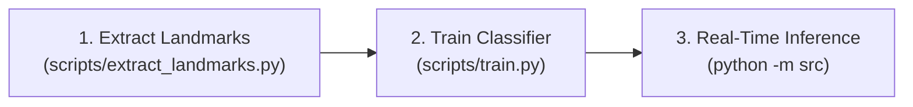

### [← Back to README](../README.md)

**Sections:** [Prerequisites and Hardware](#prerequisites-and-hardware) • [Environment Setup](#environment-setup) • [Model Assets and Verification](#model-assets-and-verification) • [Dataset Download and Preparation](#dataset-download-and-preparation) • [End-to-End Pipeline Execution](#end-to-end-pipeline-execution) • [Troubleshooting and Diagnostic FAQ](#troubleshooting-and-diagnostic-faq)

---

<br/>

# Setup and Usage Guide

## Prerequisites and Hardware

### System Requirements
- **Operating System:** Windows 10/11, Ubuntu 20.04+, or macOS 12+
- **Python Version:** Python 3.10, 3.11, or 3.12
- **Hardware:**
  - Modern multi-core CPU (Intel Core i5/AMD Ryzen 5 or higher recommended)
  - Standard USB or integrated webcam (720p or 1080p at 30 FPS)
  - 4 GB RAM minimum (8 GB recommended for dataset feature extraction)
  - 2 GB free disk space (excluding raw image dataset)

## Environment Setup

### 1. Clone or Open the Repository
Navigate to the root directory of the project:
```bash
git clone https://github.com/px7nn/ISL.git
cd "ISL"
```

### 2. Create a Virtual Environment
It is strongly recommended to isolate project dependencies within a dedicated Python virtual environment:

**On Windows (PowerShell):**
```powershell
python -m venv .venv
.\.venv\Scripts\Activate.ps1
```

**On Linux / macOS:**
```bash
python3 -m venv .venv
source .venv/bin/activate
```

### 3. Install Required Dependencies
Install the pinned libraries defined in [`requirements.txt`](../requirements.txt):
```bash
pip install --upgrade pip
pip install -r requirements.txt
```

#### Package Manifest:
| Package | Purpose |
| :--- | :--- |
| `opencv-python` | Camera capture, frame transformations, and graphic HUD rendering |
| `mediapipe` | Google MediaPipe Tasks framework for hand landmark detection |
| `numpy` | Vectorized numerical operations, matrix transformations, and binary array I/O |
| `scikit-learn` | Random Forest model, class weighting, train/test split, and evaluation metrics |
| `joblib` | High-performance serialization and persistence for scikit-learn models |
| `matplotlib` | Generation of statistical performance plots and confusion matrices |
| `seaborn` | Heatmap generation for visual evaluation artifacts |
| `tqdm` | Terminal progress monitoring during batch feature extraction |

## Model Assets and Verification

Pretrained models (`hand_landmarker.task`, `isl_classifier.pkl`, and `label_encoder.pkl`) are pre-bundled directly within the repository under `models/`. Users can run the inference pipeline immediately after cloning.

If you ever need to re-acquire the original Google MediaPipe Hand Landmarker bundle (`hand_landmarker.task`), use the official CDN link:

**PowerShell (Windows):**
```powershell
New-Item -ItemType Directory -Force -Path models
Invoke-WebRequest -Uri "https://storage.googleapis.com/mediapipe-models/hand_landmarker/hand_landmarker/float16/latest/hand_landmarker.task" -OutFile "models/hand_landmarker.task"
```

**cURL / Wget (Linux / macOS):**
```bash
mkdir -p models
curl -Lo models/hand_landmarker.task https://storage.googleapis.com/mediapipe-models/hand_landmarker/hand_landmarker/float16/latest/hand_landmarker.task
```

## Dataset Download and Preparation

If training a custom model from raw images, download the dataset from Kaggle:
- **Direct Download URL:** [https://www.kaggle.com/api/v1/datasets/download/ananyaarya22/isl-data](https://www.kaggle.com/api/v1/datasets/download/ananyaarya22/isl-data)

### Unpacking Archive
Extract the archive so that the class folders reside directly under `datasets/isl_dataset/`:

```
datasets/
└── isl_dataset/
    ├── 0/
    ├── 1/
    ├── ...
    ├── A/
    ├── B/
    └── Z/
```

Supported extensions: `.jpg`, `.jpeg`, `.png`, `.bmp`, `.webp`.

## End-to-End Pipeline Execution

The system provides a three-stage sequential workflow:



### Step 1: Extract Landmark Features
Run the extraction script to process all images in `datasets/isl_dataset/` and produce cached `.npy` archives:

```bash
python scripts/extract_landmarks.py
```

Outputs written to `datasets/processed/`:
- `features.npy`: Normalized 126-dimensional matrix of all extracted gestures.
- `labels.npy`: Corresponding class labels.
- `classes.npy`: Ordered list of unique classes.

### Step 2: Train Random Forest Classifier
Train the ensemble model on the extracted features, output evaluation metrics, and generate the confusion matrix:

```bash
python scripts/train.py
```

Outputs generated:
- `models/isl_classifier.pkl`: Trained Random Forest model.
- `models/label_encoder.pkl`: Label encoder mapping numerical IDs to class characters.
- `confusion_matrix.png`: Saved confusion matrix graphic.

### Step 3: Run Real-Time Recognition
Launch the real-time webcam recognition interface:

```bash
python -m src
```
*(Or execute directly via `python src/__main__.py`)*

#### Interactive Webcam Controls:
- **`Space`**: Append the recognized character to the sentence buffer.
- **`Backspace`**: Remove the last character from the sentence buffer.
- **`c`**: Clear the entire sentence buffer.
- **`q`**: Exit the application.

## Troubleshooting and Diagnostic FAQ

### Issue 1: `RuntimeError: Failed to open camera`
- **Cause:** OpenCV was unable to connect to video capture device index `0`.
- **Solution:** 
  1. Verify the webcam is connected and recognized by the operating system.
  2. If using an external USB camera, change the device index in [`src/__main__.py`](../src/__main__.py) from `0` to `1` or `2`:
     ```python
     cap = cv2.VideoCapture(1)
     ```
  3. Ensure other applications (Zoom, Teams, Discord, browser) are not monopolizing the camera device.

### Issue 2: `FileNotFoundError: models/hand_landmarker.task`
- **Cause:** The MediaPipe task model has not been placed in the `models/` directory.
- **Solution:** Download `hand_landmarker.task` from Google's CDN as outlined in [Downloading Model Assets](#downloading-model-assets).

### Issue 3: Inferences Display "Unknown" Persistently
- **Cause:** Detection confidence is falling below the `0.75` threshold.
- **Solution:**
  1. Improve ambient lighting to ensure clear hand edge contrast.
  2. Ensure the hand is held clearly in front of the camera with fingers fully visible.
  3. Verify that the gesture conforms to the canonical Indian Sign Language (ISL) hand configuration.
  4. If needed for testing, adjust `CONFIDENCE_THRESHOLD` in [`src/__main__.py`](../src/__main__.py).

### Issue 4: High Failure Rate During Batch Landmark Extraction
- **Cause:** Dataset images contain severe motion blur, low resolution, extreme shadows, or hands cut off by image borders.
- **Solution:** Inspect the failure counts printed at the conclusion of `scripts/extract_landmarks.py`. Review the problematic class folders to remove blurry or corrupted image files.
